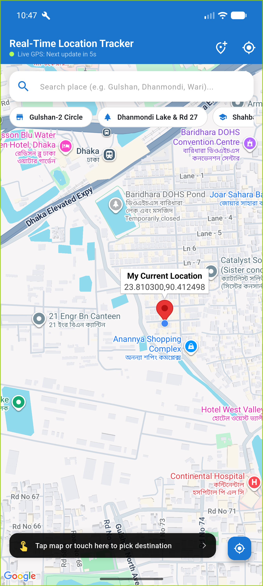
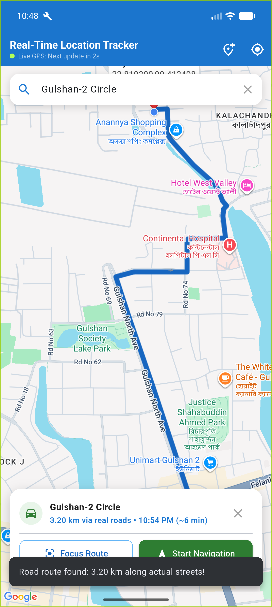
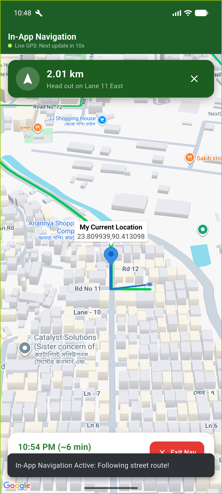

# 📍 Real-Time Location Tracker & In-App Navigation

[](https://flutter.dev)
[](https://dart.dev)
[](https://developer.android.com)
[](https://developers.google.com/maps)
[](https://opensource.org/licenses/MIT)

A production-grade, feature-rich Flutter application that tracks real-time user location, renders live polyline movement every 10 seconds, and provides **full in-app turn-by-turn navigation** along **actual road networks and street turns** using Google Maps and OSRM routing.

Built for the **Module 18 Assignment: Google Maps and Geolocator**.

---

## 📱 App Screenshots

| 1. Real-Time Tracking & InfoWindow | 2. Real Road Route Selection | 3. In-App Turn-By-Turn Navigation |
| :---: | :---: | :---: |
|  |  |  |
| *10s interval updates, marker & InfoWindow* | *Street-level routing (no straight lines)* | *3D tilted camera, Turn HUD & live ETA* |

---

## ✨ Features & Capabilities

### 1. 🔄 Automatic Map Animation & Location Centering
- On app launch, requests location permissions and fetches the current device GPS position.
- Smoothly animates the Google Map camera to the user's location with optimal zoom (`zoom: 16.0`).
- Provides a floating **"Center Location"** button to instantly re-focus on the user's position at any time.

### 2. ⏱️ 10-Second Real-Time Location Polling
- Uses `geolocator` to continuously stream or poll high-accuracy GPS coordinates every **10 seconds**.
- Live visual countdown badge in the AppBar: `🟢 Live GPS: Next update in Xs`.
- Handles edge-case telemetry jumps and teleports gracefully by validating step distances.

### 3. 📍 Interactive Markers & Detailed InfoWindows
- Drops a custom marker at the current location.
- **Assignment Compliant InfoWindow**:
  - **Title:** `My Current Location`
  - **Snippet:** `<latitude>,<longitude>`
- Automatically displays the InfoWindow on map load and upon tapping the marker.

### 4. 🛣️ Real Road Geometry & Street Routing (OSRM Engine)
- Unlike basic apps that draw a direct chord/straight line cutting through buildings, this app connects to the **Open Source Routing Machine (OSRM)** to fetch exact street coordinates (`LineString` geometry).
- Traces real turns, bridges, flyovers, and curves (Lane 11, Gulshan North Ave, etc.).
- Displays total road distance in meters/kilometers and estimated driving duration.

### 5. 🧭 100% In-App Turn-By-Turn Navigation
- **No external Google Maps app required** — navigation runs entirely inside this application.
- **3D Perspective Camera:** Tilts to **50°** and aligns bearing with direction of travel.
- **Top Turn-By-Turn HUD:** Displays real-time maneuvers (e.g., *"Head out on Lane 11 East"*, *"Turn right onto Rd 74"*) and remaining distance.
- **Live ETA Dashboard:** Shows expected arrival time, remaining street distance, and an **[Exit Nav]** button.
- Smooth simulated progression along road points for testing and evaluation.

### 6. 🔍 Effortless Multi-Mode Destination Selection
- **1-Tap Popular Spots Chips:** Horizontally scrollable chips for instant 1-tap route calculation:
  - 📍 Gulshan-2 Circle
  - 📍 Dhanmondi Lake & Rd 27
  - 📍 Shahbagh / TSC (Dhaka University)
  - 📍 Mohakhali Flyover
  - 📍 Mirpur 10 Circle
  - 📍 Uttara Sector 3
- **Map Tap & Long Press:** Single tap or long press anywhere on the map drops a green destination pin immediately and calculates the route.
- **Autocomplete Search Bar:** Type any location in Bangladesh or worldwide with live dropdown suggestions powered by OpenStreetMap Nominatim.
- **Destination Picker Bottom Sheet:** Dedicated `📍+` button opening a bottom sheet of destinations.

### 7. 🚶 Emulator Walk Simulator (Dhaka Route)
- For testing on PC Android emulators without physical GPS hardware:
- One-tap toggle in the AppBar (`🚶 Walk Icon`) simulates real-world walking along Dhaka roads every 10 seconds, continuously appending to the traveled blue polyline.

---

## 📋 Module 18 Requirements Fulfillment

| Assignment Requirement | Implementation Details | Status |
| :--- | :--- | :---: |
| **1. Automatic Map Animation** | Smooth animation via `GoogleMapController.animateCamera` to current position | ✅ Completed |
| **2. Real-Time Location Updates** | `Geolocator` polling every 10s with visual countdown indicator | ✅ Completed |
| **3. Polyline Tracking** | Dynamically appends coordinates to `_polylineCoordinates` as user moves | ✅ Completed |
| **4. Marker & InfoWindow** | Title: `My Current Location`, Snippet: `lat,lng`, auto-shown on marker | ✅ Completed |
| **5. Street Navigation & Routing** | In-app turn-by-turn navigation following actual street road curves | ✅ Completed |

---

## 🏗️ Project Architecture

```
m18/
├── android/
│   ├── app/
│   │   └── src/main/
│   │       └── AndroidManifest.xml    # Permissions & Google Maps API Key
│   └── gradle.properties             # Multi-drive build configurations
├── lib/
│   ├── main.dart                      # App entry point & Material theme
│   ├── screens/
│   │   └── location_tracker_screen.dart # Main tracking & navigation UI
│   └── services/
│       └── routing_service.dart       # OSRM road route & geocoding service
├── screenshots/
│   ├── real_time_tracking.png
│   ├── road_route_selection.png
│   └── in_app_navigation.png
└── pubspec.yaml                       # Dependencies & assets configuration
```

---

## 🚀 Getting Started

### Prerequisites
- [Flutter SDK](https://docs.flutter.dev/get-started/install) (version 3.35.x or newer)
- Android Studio / VS Code with Flutter extension
- Android Device or Android Emulator (API 28+)
- Google Maps Android API Key

### Installation

1. **Clone the repository:**
   ```bash
   git clone https://github.com/Art3MasA005/m18.git
   cd m18
   ```

2. **Install Flutter dependencies:**
   ```bash
   flutter pub get
   ```

3. **Configure Google Maps API Key:**
   Ensure your API key is in `android/app/src/main/AndroidManifest.xml`:
   ```xml
   <meta-data
       android:name="com.google.android.geo.API_KEY"
       android:value="YOUR_GOOGLE_MAPS_API_KEY" />
   ```

4. **Run on connected device or emulator:**
   ```bash
   flutter run
   ```

---

## 📦 Key Packages Used

| Package | Version | Purpose |
| :--- | :--- | :--- |
| [`google_maps_flutter`](https://pub.dev/packages/google_maps_flutter) | `^2.18.1` | Native Google Maps rendering, markers, polylines |
| [`geolocator`](https://pub.dev/packages/geolocator) | `^14.1.2` | High-accuracy GPS location querying and tracking |
| [`http`](https://pub.dev/packages/http) | `^1.6.0` | Network requests for OSRM routing and geocoding |
| [`url_launcher`](https://pub.dev/packages/url_launcher) | `^6.3.3` | External URL handling and intents |

---

## 📄 License

This project is licensed under the MIT License — see the [LICENSE](LICENSE) file for details.
